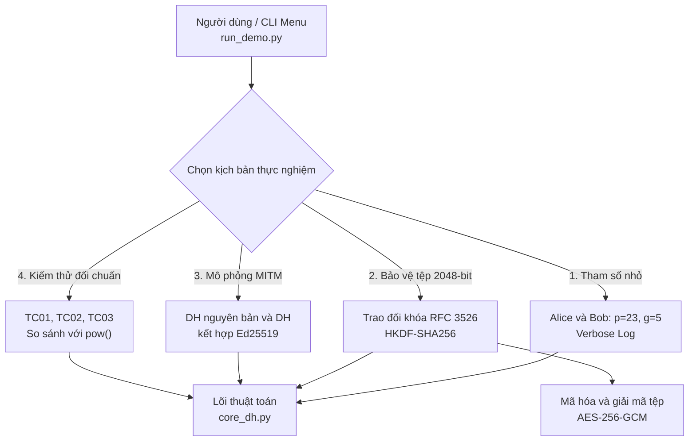

# Hệ thống trao đổi khóa Diffie–Hellman (DH)

Dự án được thực hiện trong khuôn khổ học phần **An toàn bảo mật thông tin (ATBMTT)**, nhằm nghiên cứu và cài đặt thuật toán trao đổi khóa Diffie–Hellman bằng Python. Hệ thống kết hợp lõi toán học lũy thừa modulo tự cài đặt theo phương pháp *Square-and-Multiply* với các thành phần mật mã từ thư viện `cryptography`, gồm HKDF-SHA256, AES-256-GCM và chữ ký số Ed25519.

Các chức năng chính bao gồm minh họa quá trình trao đổi khóa, mã hóa và giải mã tệp, mô phỏng tấn công người đứng giữa (MITM) và kiểm thử tính đúng đắn của thuật toán.

## 1. Kiến trúc và luồng hoạt động tổng thể

Hệ thống được tổ chức thành hai thành phần chính: `core_dh.py` chứa phần lõi Diffie–Hellman; `run_demo.py` đảm nhiệm giao diện dòng lệnh, các kịch bản thực nghiệm và bộ kiểm thử.



### Cấu trúc thư mục

Khi mới tải về, thư mục dự án bao gồm các tệp mã nguồn. Các tệp dữ liệu được tạo trong quá trình chạy Chức năng 2 theo cách triển khai của chương trình.

```text
diffie-hellman-demo/
├── core_dh.py
├── run_demo.py
├── README.md
└── (Các tệp được tạo khi chạy Chức năng 2)
    ├── van_ban_goc.txt
    ├── van_ban_ma_hoa.bin
    └── van_ban_khoi_phuc.txt
```

- `core_dh.py`: Cài đặt lũy thừa modulo và các thao tác Diffie–Hellman.
- `run_demo.py`: Điều khiển các kịch bản demo, mã hóa tệp, mô phỏng MITM và kiểm thử.
- `van_ban_goc.txt`: Tệp dữ liệu đầu vào mẫu.
- `van_ban_ma_hoa.bin`: Tệp bản mã AES-256-GCM.
- `van_ban_khoi_phuc.txt`: Tệp được tạo sau khi giải mã.

### Các thành phần mã nguồn

| Thành phần | Tệp nguồn / thư viện | Nguồn gốc | Chức năng |
|---|---|---|---|
| `power_mod()` | `core_dh.py` | Tự cài đặt | Tính lũy thừa modulo bằng Square-and-Multiply |
| `DiffieHellmanEntity` | `core_dh.py` | Tự cài đặt | Quản lý tham số, khóa riêng, khóa công khai và bí mật chung |
| Verbose Log | `core_dh.py` | Tự cài đặt | Hiển thị các bước tính toán trung gian |
| CLI và Test Suite | `run_demo.py` | Tự cài đặt | Điều khiển demo và kiểm thử đối chuẩn |
| HKDF-SHA256 | `cryptography` | Thư viện bên thứ ba | Dẫn xuất khóa từ bí mật chung |
| AES-256-GCM | `cryptography` | Thư viện bên thứ ba | Mã hóa và xác thực dữ liệu |
| Chữ ký số Ed25519 | `cryptography` | Thư viện bên thứ ba | Ký và xác minh dữ liệu trao đổi khóa |
| `os.urandom()` | `os` | Thư viện chuẩn Python | Sinh dữ liệu ngẫu nhiên |

## 2. Môi trường và cài đặt

**Yêu cầu hệ thống**

- Python 3.8 trở lên.
- Windows, Linux hoặc macOS.
- Thư viện bên thứ ba `cryptography`.

Cài đặt thư viện:

```bash
pip install cryptography
```

Khởi chạy chương trình từ thư mục dự án:

```bash
python run_demo.py
```

## 3. Hướng dẫn chạy code và kết quả thực nghiệm

### Chức năng 1: Minh họa với bộ tham số nhỏ

Sử dụng $p = 23$, $g = 5$, khóa riêng Alice $a = 6$ và Bob $b = 15$. Chế độ Verbose Log hiển thị các bước tính lũy thừa modulo.

Kết quả:

- Khóa công khai Alice: $A = 8$.
- Khóa công khai Bob: $B = 19$.
- Khóa bí mật chung: $K = 2$.

### Chức năng 2: Trao đổi khóa 2048-bit và bảo vệ tệp

Sử dụng nhóm MODP Group 14 theo RFC 3526 để thực hiện trao đổi khóa. Bí mật chung được đưa qua HKDF-SHA256 để dẫn xuất khóa 256-bit, sau đó dùng AES-256-GCM để mã hóa tệp.

Chương trình tạo tệp đầu vào, bản mã và tệp khôi phục, đồng thời ghi nhận thời gian thực thi và đối chiếu mã băm SHA-256.

Ví dụ đầu ra:

```text
[+] Đã cập nhật nội dung tệp tin gốc: "Nhóm 6 - ATBMTT"
[*] Thời gian sinh khóa riêng ngẫu nhiên:    0.000064 giây
[*] Thời gian trao đổi và tính toán DH:      0.114791 giây
[✓] Tệp mã hóa: van_ban_ma_hoa.bin (44 bytes)
[✓] SHA-256 tệp gốc:      2eba72efd6f577605fe2a8237ae2669f2521392d498391efb8729b82a38b8412
[✓] SHA-256 tệp khôi phục: 2eba72efd6f577605fe2a8237ae2669f2521392d498391efb8729b82a38b8412
[✓] Kết quả đối chiếu: TRÙNG KHỚP
```

*Thời gian thực thi có thể thay đổi theo môi trường và từng lần chạy.*

### Chức năng 3: Mô phỏng tấn công MITM

Chức năng này so sánh hai kịch bản trao đổi khóa trên kênh truyền không an toàn:

- **DH nguyên bản:** Không xác thực khóa công khai, nên có nguy cơ bị kẻ tấn công xen giữa và thiết lập khóa riêng biệt với mỗi bên.
- **DH kết hợp Ed25519:** Sử dụng chữ ký số để xác minh dữ liệu trao đổi khóa và phát hiện chữ ký không hợp lệ.

Cơ chế xác thực chỉ có hiệu quả khi khóa công khai dùng để xác minh chữ ký được phân phối hoặc xác thực một cách đáng tin cậy.

### Chức năng 4: Bộ kiểm thử đối chuẩn

Hàm tự cài đặt `power_mod()` được đối chiếu với hàm `pow(base, exp, mod)` của Python qua ba ca kiểm thử:

- `TC01`: Bộ tham số 5-bit.
- `TC02`: Bộ tham số 64-bit.
- `TC03`: Bộ tham số 2048-bit theo RFC 3526.

Mục tiêu là kiểm tra sự tương đồng của kết quả tính lũy thừa modulo ở các kích thước đầu vào khác nhau.

## 4. Lưu ý an toàn

Chương trình được xây dựng phục vụ mục đích học tập và minh họa thuật toán Diffie–Hellman, chưa phải một triển khai hoàn chỉnh để sử dụng trong môi trường thực tế.

Hàm power_mod() tự cài đặt chưa áp dụng kỹ thuật thực thi thời gian hằng (constant-time execution), nên có thể tồn tại nguy cơ tấn công kênh kề. Ngoài ra, Diffie–Hellman nguyên bản không tự xác thực danh tính đối phương, do đó cần kết hợp cơ chế xác thực phù hợp để hạn chế tấn công MITM.
